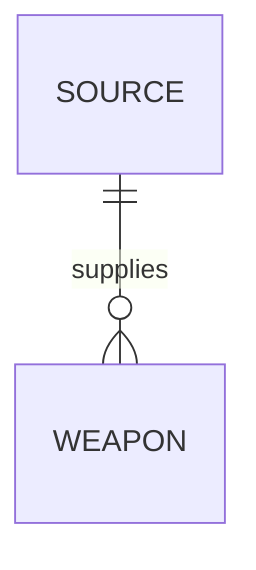
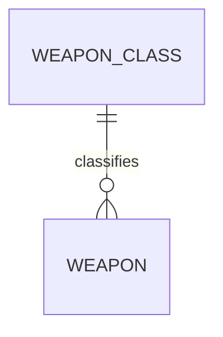
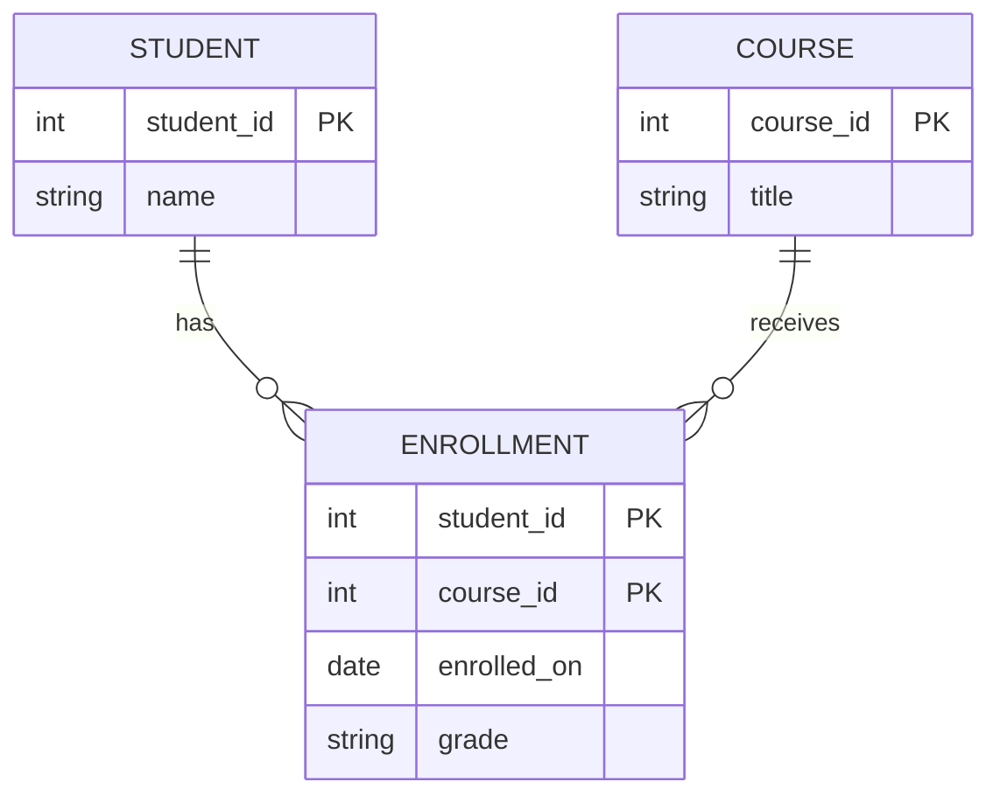
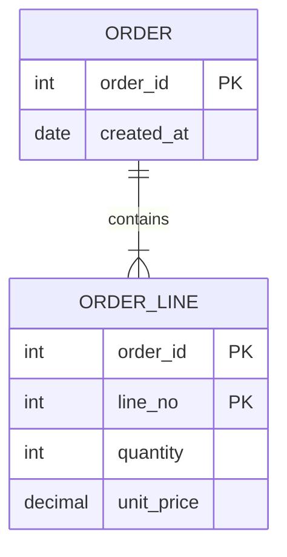
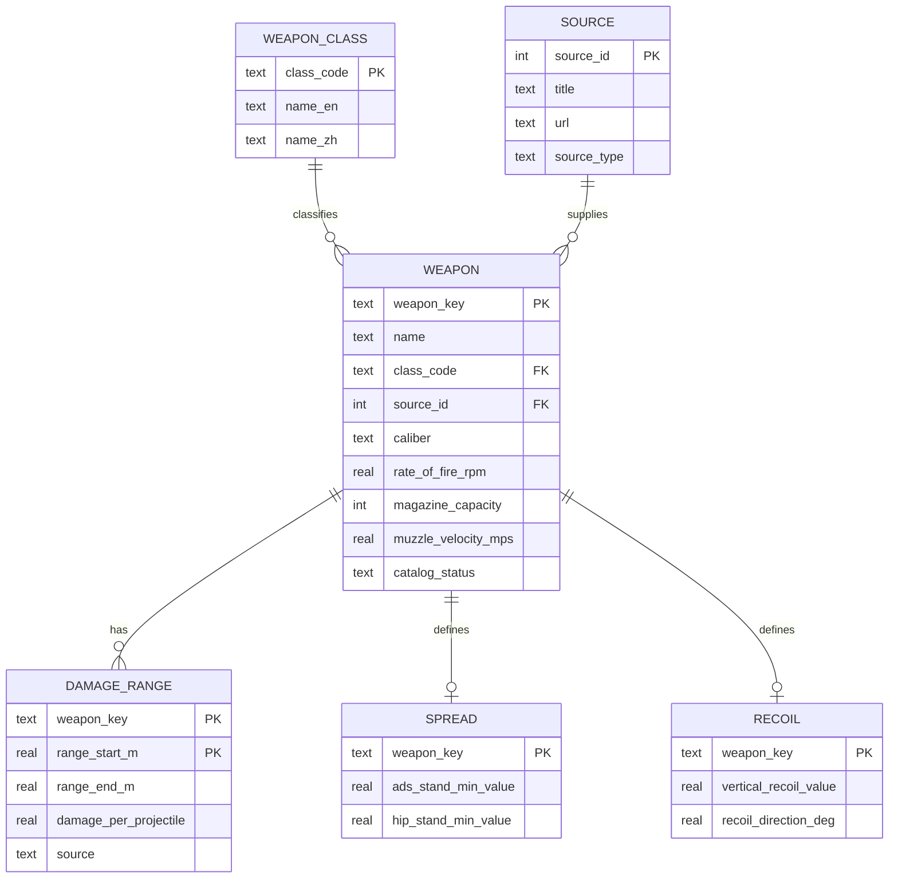
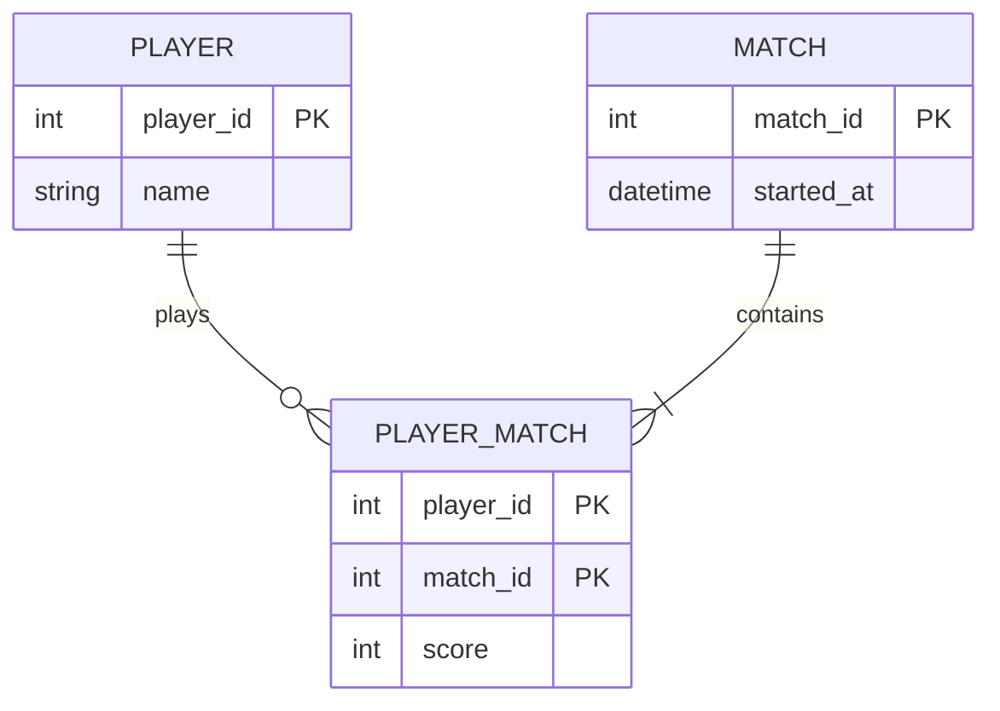

关联：CS50数据库入门0-SQL的安装与命令行查找操作 · CS50数据库入门1--处理拥有多个表格的数据库

ERD（Entity Relationship Diagram，实体关系图）是数据库结构和业务规则的图形化表达。它不只回答“有哪些表”，还要回答：

- 哪些对象应该成为实体；
- 每个实体有哪些属性；
- 用什么属性唯一区分一条记录；
- 实体之间是一对一、一对多还是多对多；
- 一个关系是必须参加还是可以缺席；
- 哪些联系会变成外键，哪些必须独立成表。

可以把 ERD 理解成建筑施工图，把 `.sql` 建表语句理解成实际施工。ERD 先确定结构，SQL 再把它变成数据库。

## 1. ERD 的三个层次

| 层次 | 关注内容 | 常见形式 | 适合谁看 |
| --- | --- | --- | --- |
| 概念 ERD | 业务实体、联系和基数 | 矩形、菱形或简化连线 | 需求分析、业务讨论 |
| 逻辑 ERD | 实体、属性、主键、外键 | 带字段的实体框、Crow's Foot 连线 | 数据库设计 |
| 物理模型 | 具体数据类型、索引、约束、触发器 | 建表语句、物理数据模型图 | 实现和运维 |

三者回答的问题逐渐具体：

1. “一名学生可以选修多少门课？”
2. “学生和课程之间是多对多，需要一张选课表。”
3. “选课表使用 `(student_id, course_id)` 复合主键，并给外键建索引。”

ERD 本身不是 SQL，也不负责决定某个数据库是否必须使用 `INTEGER`、`TEXT` 或 `REAL`。这些属于逻辑模型和物理模型的细化。（只是一张表）

## 2. 实体、实例和属性

### 2.1 实体与实例

- **实体（Entity）**：需要长期保存的一类对象，例如“枪械”“枪械类型”“伤害分段”。
- **实体实例（Entity Instance）**：该类对象中的一个具体成员，例如 `M433`、`AK4D`。
- **实体集（Entity Set）**：若干同类实例的集合。

建模时先找名词，但名词不一定都要成为实体。如果一个属性可以独立存在、被多个对象引用，或本身还有多个属性，它通常应该拆成实体。

例如：

```text
枪械类型 = 突击步枪
```

如果只有类型名称，它可以是 `weapons` 表中的一列。但当类型还要保存英文名、显示顺序、说明时，独立成 `weapon_classes` 表更合适。

### 2.2 属性的类型

| 属性类型 | 含义                 | 建模方式               |
| ---- | ------------------ | ------------------ |
| 简单属性 | 不可再分，如 `damage`    | 直接作为列              |
| 复合属性 | 由多个部分构成，如完整地址      | 通常拆成多列，或拆成独立实体     |
| 单值属性 | 一个实例只有一个值，如枪械名称    | 普通列                |
| 多值属性 | 一个实例可有多个值，如多把备用枪   | 拆成独立表，不用逗号塞进一个单元格  |
| 派生属性 | 可由其他数据计算，如总伤害、平均射速 | 通常查询时计算；仅在有性能需求时缓存 |
| 可选属性 | 可以为空，如尚未公布的伤害      | 允许 `NULL`          |

### 2.3 键的分类

| 键 | 作用 |
| --- | --- |
| 候选键（Candidate Key） | 能唯一标识实体实例的一组属性 |
| 主键（Primary Key，PK） | 从候选键中选出的主标识 |
| 备用键（Alternate Key） | 没被选为主键的其他候选键 |
| 复合键（Composite Key） | 由多个属性共同组成的主键 |
| 外键（Foreign Key，FK） | 引用另一个实体主键或唯一键的属性 |
| 代理键（Surrogate Key） | 系统生成、没有业务含义的键，如自增整数 |
| 自然键（Natural Key） | 有业务含义且唯一的键，如 `weapon_key` |

选择主键的实用标准：

- 必须唯一；
- 不能为 `NULL`；
- 尽量稳定，不随业务改名而改变；
- 尽量简短，避免复制到很多子表中造成浪费；
- 优先使用不暴露业务含义的代理键，除非自然键确实稳定。

## 3. 关系、基数和参与度

关系描述实体实例怎样相互关联。最常见的是二元关系，即两个实体之间的联系。

### 3.1 三种最大基数

| 关系 | 含义 | 例子 |
| --- | --- | --- |
| 1:1 | 一个 A 最多对应一个 B，一个 B 也最多对应一个 A | 一把枪对应零或一份原始快照 |
| 1:N | 一个 A 可以对应多个 B，一个 B 最多对应一个 A | 一个类型包含多把枪；每把枪属于一个类型 |
| M:N | 一个 A 可以对应多个 B，一个 B 也可以对应多个 A | 多名玩家参加多场比赛 |

### 3.2 最大基数不等于参与度

这是 ERD 中最容易读错的地方。

- **最大基数**：最多能有多少个对应实例。
- **最小参与度**：至少要有多少个对应实例，常见为 0 或 1。

例如：



要从两端分别阅读：

1. 每把 `WEAPON` 恰好属于 `1` 个 `SOURCE`；
2. 每个 `SOURCE` 可以提供 `0` 把、`1` 把或多把 `WEAPON`。

所以这是“一个来源对应零到多把枪，每把枪必须有一个来源”的 1:N 关系，不只是简单的“1 对多”。

### 3.3 自反关系和多元关系

- **自反关系（Unary Relationship）**：实体和自身发生联系，如员工表中的“经理管理员工”。
- **三元关系（Ternary Relationship）**：三个实体共同参与一个关系。不要因为绘图困难就把三元关系硬拆成三个二元关系，否则可能丢失联合约束。

## 4. Crow's Foot 符号怎么读

Mermaid ERD 使用接近 Crow's Foot 的符号。先看每个端点表示“最少几个、最多几个”：

| 端点符号 | 基数含义 |
| --- | --- |
| <code>&#124;&#124;</code> | 恰好一个 |
| <code>o&#124;</code> 或 <code>&#124;o</code> | 零个或一个 |
| <code>&#124;{</code> 或 <code>}&#124;</code> | 一个或多个 |
| <code>o{</code> 或 <code>}o</code> | 零个或多个 |

关系中间的两条横线表示关系类型：

- 实线 `--`：强关系或标识关系；
- 虚线 `..`：非标识关系。

例如：



读法是：

- 一个类型可以包含零把或多把枪；
- 每把枪必须恰好属于一个类型。

Crow's Foot 的“脚”表示多端，“双竖线”表示强制且唯一的一端。

## 5. 三种关系如何落成表

### 5.1 一对一（1:1）

把外键放在其中一张表里，并给外键加 `UNIQUE`，防止同一个主实体被引用多次。

```sql
CREATE TABLE weapons (
    weapon_key TEXT PRIMARY KEY,
    name TEXT NOT NULL UNIQUE
);

CREATE TABLE weapon_raw_records (
    weapon_key TEXT PRIMARY KEY
        REFERENCES weapons(weapon_key)
        ON DELETE CASCADE,
    snapshot_json TEXT NOT NULL
);
```

这里把 `weapon_key` 同时作为主键和外键。主键天然唯一，因此一把枪最多有一份原始记录。

### 5.2 一对多（1:N）

外键放在“多”的一端。

```sql
CREATE TABLE weapon_classes (
    class_code TEXT PRIMARY KEY,
    name_zh TEXT NOT NULL
);

CREATE TABLE weapons (
    weapon_key TEXT PRIMARY KEY,
    name TEXT NOT NULL,
    class_code TEXT NOT NULL
        REFERENCES weapon_classes(class_code)
);
```

每把枪只有一个 `class_code`，而同一个 `class_code` 可以出现在多把枪中。

### 5.3 多对多（M:N）

关系数据库不能只在两张表里各塞一个外键来表示多对多。必须建立一张关联表，也叫连接表或桥接表。

原关系：


转换为实体：



`ENROLLMENT` 是关联实体，通常使用 `(student_id, course_id)` 作为复合主键。它还可以保存选课时间、成绩、状态等只属于“这名学生选这门课”这一关系的属性。

## 6. 弱实体、关联实体和继承

### 6.1 弱实体

弱实体不能只靠自己的属性唯一识别，必须依赖拥有它的强实体。

例如订单明细：



`ORDER_LINE` 单独一个 `line_no = 1` 不唯一，因为每张订单都可能有第 1 行。完整主键是：

```text
(order_id, line_no)
```

这就是弱实体依赖强实体形成复合主键的典型形式。

### 6.2 关联实体

关联实体主要用来消解多对多关系，并保存关系自身的属性。上面的 `ENROLLMENT` 就是关联实体。

### 6.3 继承关系

当多个实体共享大量属性，又有各自特殊属性时，可能出现泛化关系：

```text
枪械
├── 突击步枪
├── 狙击步枪
└── 霰弹枪
```

可以转换为：

- 单表继承：一张表加 `kind` 列；
- 类表继承：公共字段一张表，各类特殊字段各自一张表；
- 具体表继承：每个子类型都保存完整字段。

ERD 可以先表达概念继承，最终选择哪种物理方案要结合查询方式、数据量和约束强度决定。

## 7. 用枪械数据库读一张 ERD

下面的图表示一个适合入门理解的关系骨架：



逐条阅读：

1. `WEAPON_CLASS ||--o{ WEAPON`：一个类型可以包含零把或多把枪，每把枪必须恰好有一个类型。
2. `SOURCE ||--o{ WEAPON`：一个来源可以记录零把或多把枪，每把枪必须有一个来源。
3. `WEAPON ||--o{ DAMAGE_RANGE`：每把枪可以有零个或多个伤害分段，每个伤害分段只属于一把枪。当前物理库允许 `catalog_only` 新枪暂时没有伤害数据；若只针对已完成数值的枪械，业务规则可以进一步收紧为“至少一个”。
4. `WEAPON ||--o| SPREAD`：每把枪最多有一组散布数据。
5. `WEAPON ||--o| RECOIL`：每把枪最多有一组后坐力数据。

伤害分段的主键是 `(weapon_key, range_start_m)`。同一把枪可以有多个分段，但在同一把枪里，分段起点不能重复。

## 8. 从 ERD 转换为 SQLite 表

一个可直接运行的最小示例：

```sql
PRAGMA foreign_keys = ON;

CREATE TABLE weapon_classes (
    class_code TEXT PRIMARY KEY,
    name_zh TEXT NOT NULL
);

CREATE TABLE weapons (
    weapon_key TEXT PRIMARY KEY,
    name TEXT NOT NULL UNIQUE,
    class_code TEXT NOT NULL,
    catalog_status TEXT NOT NULL
        CHECK (catalog_status IN ('complete', 'catalog_only')),
    FOREIGN KEY (class_code)
        REFERENCES weapon_classes(class_code)
        ON UPDATE CASCADE
        ON DELETE RESTRICT
);

CREATE TABLE weapon_damage_ranges (
    weapon_key TEXT NOT NULL,
    range_start_m REAL NOT NULL CHECK (range_start_m >= 0),
    range_end_m REAL CHECK (
        range_end_m IS NULL OR range_end_m > range_start_m
    ),
    damage_per_projectile REAL NOT NULL
        CHECK (damage_per_projectile > 0),
    PRIMARY KEY (weapon_key, range_start_m),
    FOREIGN KEY (weapon_key)
        REFERENCES weapons(weapon_key)
        ON UPDATE CASCADE
        ON DELETE CASCADE
);
```

对应关系：

| ERD 元素 | SQLite 实现 |
| --- | --- |
| 强实体 | 独立表 |
| 1:N 的“多”端 | 子表外键 |
| 1:1 | 外键加 `UNIQUE`，或用共享主键 |
| M:N | 独立关联表和复合主键 |
| 弱实体 | 复合主键包含强实体主键 |
| 必选关系 | 外键列 `NOT NULL` |
| 可选关系 | 外键列允许 `NULL` |
| 删除父记录时处理子记录 | `ON DELETE CASCADE`、`RESTRICT` 或 `SET NULL` |

SQLite 默认不一定启用外键检查。建立连接后执行：

```sql
PRAGMA foreign_keys = ON;
```

检查当前是否启用：

```sql
PRAGMA foreign_keys;
```

返回 `1` 表示开启，返回 `0` 表示关闭。

> **注意：ERD 画得出，不等于 SQL 都能自动约束**
> `NOT NULL` 可以限制“必须属于一个父实体”，但普通 SQLite 外键很难直接强制“每个父实体至少有一个子实体”。例如“每把枪必须至少有一个伤害分段”通常需要事务、触发器或应用层校验。

## 9. Mermaid ERD 语法速查

在 Obsidian 中建立代码块：

````markdown

````

实际渲染效果：


`PK`、`FK`、`UK` 在 Mermaid 中主要是可视化标记，并不会自动创建数据库约束。真正的约束仍需写进 `CREATE TABLE` 或 `ALTER TABLE`。

## 10. ERD 与范式的关系

ERD 和范式不是同一个步骤：

- ERD 先把业务实体及关系画清楚；
- 转换成关系表后，再用范式检查重复和异常；
- 最后根据查询场景决定索引、缓存字段和是否有限反规范化。

入门阶段可以记住三个检查点：

1. 单元格是否保持原子性，不把多个值塞进一个字段；
2. 非主属性是否依赖整个复合主键；
3. 是否出现了本可推导、却重复存储并可能互相矛盾的数据。

例如一把枪的 `damage` 不应根据另一张表的伤害分段重复存进 `weapons`，除非它明确是经过批准的缓存字段。

## 11. 读 ERD 的固定步骤

拿到一张图后，按以下顺序读：

1. 找出所有实体及其主键；
2. 对每条关系分别从左向右、从右向左阅读；
3. 确定最大基数：1 还是多；
4. 确定最小参与度：0 还是 1；
5. 检查外键应放在哪一端；
6. 遇到多对多，寻找关联实体；
7. 检查删除规则和空值规则；
8. 用两条样例数据验证图形是否能表达业务事实；
9. 最后转换为 SQL，并执行外键与完整性检查。

## 12. 常见错误

| 错误 | 后果 | 修正 |
| --- | --- | --- |
| 只说“1 对多”，不说明方向 | 外键可能放到反方向 | 从两端分别读出基数和参与度 |
| 多值属性用逗号塞进一列 | 查询、连接和更新困难 | 拆成子表 |
| 多对多只在两张表相互放外键 | 冗余、难约束、难扩展 | 建立关联表 |
| 用可能重复的名称做主键 | 无法稳定唯一标识 | 使用稳定的自然键或代理键 |
| 忘记 `NOT NULL` | ERD 要求必选，数据库却允许缺失 | 在物理模型添加约束 |
| 在 SQLite 忘记开启外键 | 外键声明存在但检查未启用 | 每个连接执行 `PRAGMA foreign_keys = ON` |
| 把 Mermaid 的 `PK` 当成真实约束 | 图正确但数据库没有约束 | 在建表语句中真正定义 |
| 把派生数据重复存储 | 数据可能互相矛盾 | 计算或明确作为缓存维护 |

## 13. 入门练习

### 练习 1：枪械与类型

条件：

- 一个枪械类型可以包含多把枪；
- 每把枪必须属于一个类型；
- 类型可以暂时没有枪。

请画出 ERD，并判断外键放在哪张表。

答案要点：

- `WEAPON_CLASS ||--o{ WEAPON`；
- `class_code` 外键放在 `WEAPON`；
- `WEAPON.class_code` 应为 `NOT NULL`。

### 练习 2：球员与比赛

条件：

- 一名球员可以参加多场比赛；
- 一场比赛有多名球员；
- 需要保存该球员在这场比赛中的得分。

答案要点：

- 这是 M:N；
- 建立 `PLAYER_MATCH(player_id, match_id, score)`；
- 复合主键为 `(player_id, match_id)`；
- `score` 属于关联实体，不属于球员或比赛本身。

### 练习 3：来源与枪械

条件：

- 每把枪只能有一个主要来源；
- 一个来源可以记录多把枪；
- 新来源允许暂时没有枪；
- 删除来源时不能留下孤立枪械。

答案要点：

- 关系为 `SOURCE ||--o{ WEAPON`；
- `source_id` 放在 `WEAPON` 且 `NOT NULL`；
- 删除来源端使用 `ON DELETE RESTRICT`，先处理相关枪械；
- 来源可以暂时无枪，因此另一端最小基数为 `0`。

## 14. 一页速查

| 问题 | 判断 |
| --- | --- |
| 这个名词是否要独立保存多个属性？ | 是则考虑成为实体 |
| 一段数据能否用逗号塞入一个字段？ | 多值属性通常应拆表 |
| 两条记录靠什么唯一区分？ | 设计主键 |
| 一个 A 能否对应多个 B？ | 判断最大基数 |
| 一个 A 是否必须至少有一个 B？ | 判断最小参与度 |
| 关系是多对多吗？ | 建关联实体 |
| 子记录离开父记录能否存在？ | 决定外键是否允许 `NULL` |
| 删除父记录后子记录怎么办？ | 选择 `CASCADE`、`RESTRICT` 或 `SET NULL` |
| ERD 与 SQL 是否一致？ | 用真实建表语句验证 |

## 15. 资料来源

- [Mermaid Entity Relationship Diagrams](https://mermaid.js.org/syntax/entityRelationshipDiagram.html)：ERD 图形语法、属性、主键标记和关系基数。
- [SQLite Foreign Key Support](https://www.sqlite.org/foreignkeys.html)：外键定义、启用方式和父键要求。
- [Obsidian Advanced formatting syntax](https://help.obsidian.md/Editing+and+formatting/Advanced+formatting+syntax)：Obsidian 中 Mermaid 代码块的使用。

## 16. 关联笔记

- CS50数据库入门0-SQL的安装与命令行查找操作
- CS50数据库入门1--处理拥有多个表格的数据库
