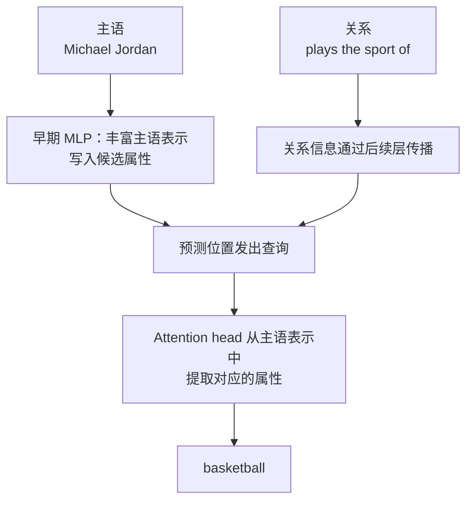

> **视频**：[BV1idpkzsEwZ 第 9 分 P：直观解释大语言模型如何储存事实](https://www.bilibili.com/video/BV1idpkzsEwZ/?p=9)
>
> **原版**：[How might LLMs store facts?](https://www.youtube.com/watch?v=9-Jl0dxWQs8)
> **官方文字版**：[3Blue1Brown: How might LLMs store facts](https://www.3blue1brown.com/lessons/mlp)

## 0. 先给结论

这一期真正想回答的不是“模型把一句话写进了哪个格子”，而是：

> **训练后的参数如何让某个输入激活模式触发某个输出方向，从而让模型更可能说出某条知识？**

可以压缩成三句话：

1. **事实不是数据库中的一条独立记录。** 它更像是由许多权重共同形成的“条件关联”：当表示中出现某些特征时，网络就提高另一些特征的激活。
2. **MLP 可以看成一个“读特征、做判断、写特征”的模块。** 第一个矩阵主要读取输入，ReLU/GELU 做非线性筛选，第二个矩阵把激活结果写回向量。
3. **单个神经元通常不等于一个干净概念。** 真实模型大量使用叠加表示（superposition），一个特征由一组神经元和方向共同编码。

3B1B 用“Michael Jordan 打篮球”作为玩具例子。这个例子很适合建立直觉，但不能直接理解成：模型里真的有一个“Michael Jordan 打篮球神经元”。

---

## 1. Transformer 中的位置

### 1.1 总体数据流


Attention 和 MLP 的分工可以先粗略记成：

| 模块 | 是否跨 token 交换信息 | 主要直觉 |
|---|---:|---|
| Attention | 是 | 决定“当前位置应该从哪些位置读取什么信息” |
| MLP | 否 | 对每个位置当前的向量做非线性特征变换，再把结果写回 |

一个常见比喻是：

- **Attention** 像在会议中互相传纸条；
- **MLP** 像每个人拿到纸条后，自己查表、做判断、补充想法。

这个比喻只用于建立直觉，不代表 MLP 真的在查一张离散表。

### 1.2 残差流

MLP 的输出不会替换原向量，而是被加回：

$$
\mathbf{x}' = \mathbf{x} + \operatorname{MLP}(\mathbf{x})
$$

因此可以把一路传下去的高维向量看成一个 **residual stream（残差流）**：

- Attention 从其他位置读信息，并写回当前向量；
- MLP 读取当前向量，经过变换后，再写入新的特征；
- 后面的层可以继续读取这些特征。

事实并不是在某一层突然出现的一条字符串，而是多层不断“补充特征”后形成的激活状态。

---

## 2. “储存事实”到底是什么意思？

给定：

> Michael Jordan plays the sport of ___

模型预测 `basketball` 的概率较高。这里所谓的“储存”，至少包含三个条件：

1. 输入中出现了 Michael、Jordan 以及“运动项目”这一关系；
2. 网络内部某些方向被激活；
3. 这些激活通过后续权重，使 `basketball` 对应的输出方向得分升高。

所以更准确的说法是：

> 模型参数共同编码了“在某种上下文中，Michael Jordan 与 basketball 有较强关联”这一统计结构。

### 2.1 为什么它不像数据库？

| 角度 | 数据库里的记录 | 大语言模型中的事实关联 |
|---|---|---|
| 存储单位 | 一行、一个键值对、一条文档 | 大量权重和激活方向 |
| 查找方式 | 用明确的键查询 | 由连续向量激活模式触发 |
| 写入方式 | 显式 `INSERT` / `UPDATE` | 训练时通过梯度下降调整大量参数 |
| 是否可精确定位 | 通常可以 | 往往只能做因果追踪和近似定位 |
| 是否会互相干扰 | 设计得当时较少 | 叠加表示会带来干扰和竞争 |

模型没有必要为每个事实保存一句完整文本。它只需要在某个上下文里，让正确属性方向获得足够高的分数。

### 2.2 参数知识与上下文知识

这里还要区分两种“知道”：

- **参数知识**：训练后写入权重中的知识，例如模型在世界知识问答中回忆出的常识。
- **上下文知识**：直接出现在 prompt 或检索结果里的信息。模型通过 attention 在当前上下文中使用它。

这一期主要讨论第一类，也就是事实关联如何可能被写入模型参数。

---

## 3. 用方向表示特征

### 3.1 高维向量不是一串没有结构的数字

Transformer 中的向量维度很高。GPT-3 的 embedding 维度是：

$$
d_{\text{model}} = 12\,288
$$

可以把某些方向理解为特征：

- 方向 $\mathbf{M}$：first name Michael；
- 方向 $\mathbf{J}$：last name Jordan；
- 方向 $\mathbf{B}$：basketball。

如果输入向量是 $\mathbf{x}$，那么它与某个方向 $\mathbf{r}$ 的点积

$$
\mathbf{r}\cdot\mathbf{x}
$$

可以看成这个方向上被激活了多少。

严格地说：

- 如果 $\mathbf{r}$ 和 $\mathbf{x}$ 都是单位向量，点积就是余弦相似度；
- 如果不做归一化，点积的大小还受向量长度影响；
- 真实模型的激活值也不一定限制在 $[0,1]$。

视频为了直观，暂时假设点积在 0 和 1 附近，并把“同时出现 Michael 和 Jordan”简化成两个特征各贡献 1。

### 3.2 注意力先把上下文送到当前 token

“Michael”和“Jordan”通常是两个 token。为了让 `Jordan` 位置的向量同时知道 first name 和 last name，前面的 attention 层需要把 Michael 的信息传过来。

可以简化成：

$$
\mathbf{x}_{\text{Jordan}} \approx \mathbf{M} + \mathbf{J}
$$

这里还有一个后续会补上的重要问题：**“篮球”这个回答是由“运动项目”关系选择的，不只是由姓名选择的。** 视频的玩具例子先把这个关系条件隐藏了。

---

## 4. MLP 的四个步骤

Transformer 里的 MLP 通常可以写成：

$$
\begin{aligned}
\mathbf{u} &= W_\uparrow \mathbf{x} + \mathbf{b}_\uparrow, \\
\mathbf{h} &= \phi(\mathbf{u}), \\
\mathbf{y} &= W_\downarrow \mathbf{h} + \mathbf{b}_\downarrow, \\
\mathbf{x}' &= \mathbf{x} + \mathbf{y}.
\end{aligned}
$$

其中：

- $W_\uparrow$：up projection，把向量从 $d_{\text{model}}$ 维扩展到更大的中间维度；
- $\mathbf{b}_\uparrow$：扩展层的偏置；
- $\phi$：ReLU、GELU 等逐元素非线性函数；
- $\mathbf{h}$：中间层神经元激活；
- $W_\downarrow$：down projection，把中间表示投回 $d_{\text{model}}$ 维；
- $\mathbf{b}_\downarrow$：输出偏置；
- $\mathbf{x}'$：加回残差流后的新向量。

### 4.1 第一步：向上投影——读特征

矩阵乘法可以按行理解：

$$
u_i = \mathbf{r}_i \cdot \mathbf{x} + b_i
$$

第 $i$ 行 $\mathbf{r}_i$ 可以看成一道“问题”：

- 输入向量在多大程度上对齐“Michael”？
- 在多大程度上对齐“Jordan”？
- 在多大程度上对齐某个抽象概念、语法结构或上下文模式？

这些行不是人工写定的规则，而是训练得到的参数。

### 4.2 第二步：非线性——筛选特征

视频先用 ReLU：

$$
\operatorname{ReLU}(u) = \max(0,u)
$$

它把负值裁成 0，正值保留。

在玩具例子中，这会制造一个类似“与门”的效果：

$$
\operatorname{ReLU}(a+b-1)
$$

只有 $a$ 和 $b$ 都足够大时，输出才明显大于 0。

但要注意：

> ReLU 不是字面意义上的逻辑与门。它只是在一个经过设计的玩具例子里，能模拟“两个条件同时成立才触发”的效果。

真实模型常用 GELU。它和 ReLU 的基本轮廓相似，但过渡更平滑，不是简单的硬阈值。

### 4.3 第三步：向下投影——写特征

$W_\downarrow$ 可以按列理解：

$$
\mathbf{y} = h_1\mathbf{c}_1 + h_2\mathbf{c}_2 + \cdots + h_m\mathbf{c}_m
$$

其中 $\mathbf{c}_i$ 是第 $i$ 列。

如果第 $i$ 个神经元激活 $h_i>0$，它就沿着方向 $\mathbf{c}_i$ 向残差流写入一部分内容。

所以可以先粗略记成：

- **$W_\uparrow$ 的行**：读什么、检测什么；
- **$W_\downarrow$ 的列**：某个神经元激活后，写出什么。

### 4.4 第四步：残差相加

MLP 计算出的 $\mathbf{y}$ 被加回原向量：

$$
\mathbf{x}' = \mathbf{x} + \mathbf{y}
$$

这样原来的信息不会完全消失，新特征只是在原表示上叠加。

---

## 5. Michael Jordan 玩具例子

### 5.1 构造一个“姓名检测器”

设第一条投影行近似为：

$$
\mathbf{r}_0 \approx \mathbf{M} + \mathbf{J}
$$

并设对应偏置为：

$$
b_0 = -1
$$

当输入向量同时包含 Michael 和 Jordan，且两个特征各贡献 1 时：

$$
u_0 = (\mathbf{M}+\mathbf{J})\cdot(\mathbf{M}+\mathbf{J})-1
$$

在玩具假设下，正交方向之间点积为 0，因此：

$$
u_0 \approx 1+1-1=1
$$

经过 ReLU：

$$
h_0 = \operatorname{ReLU}(1)=1
$$

### 5.2 为什么需要偏置

如果没有 $-1$，那么只要出现 Michael 或 Jordan 中的一个，输出就可能已经为正，容易把 Michael Phelps 或 Alexis Jordan 也误触发。

加上偏置后，可以用下面的简化表理解：

| Michael 特征 | Jordan 特征 | 线性分数 $a+b-1$ | ReLU 输出 |
|---:|---:|---:|---:|
| 1 | 1 | 1 | 1，激活 |
| 1 | 0 | 0 | 0，不激活 |
| 0 | 1 | 0 | 0，不激活 |
| 0 | 0 | -1 | 0，不激活 |

这就像一个“只有两个姓名特征同时出现才打开”的开关。

### 5.3 把 basketball 写回向量

再假设 $W_\downarrow$ 的第一列近似为：

$$
\mathbf{c}_0 \approx \mathbf{B}
$$

当第一个神经元激活时，输出会增加 basketball 方向：

$$
\mathbf{y} \approx \mathbf{B}
$$

最终：

$$
\mathbf{x}' \approx \mathbf{M}+\mathbf{J}+\mathbf{B}
$$

后续层和 unembedding 会把这个向量转化为对下一个 token 的分数，使 `basketball` 比 `tennis`、`football` 等候选词更容易被选中。

### 5.4 同一个玩具事实如何分布在参数中

| 需要学会的东西 | 在玩具模型中的位置 |
|---|---|
| Michael、Jordan 两个条件同时成立 | $W_\uparrow$ 的第一行 + 第一个偏置 |
| 什么时候算“同时成立” | ReLU/GELU 的非线性与偏置阈值 |
| 要输出哪个属性 | $W_\downarrow$ 的第一列 |
| 信息如何保留并传给后续层 | 残差相加 |

因此“事实在 MLP 里”更准确的意思是：

> 检测条件、阈值和输出方向分布在多个参数中；训练让它们的组合在特定输入下触发。

### 5.5 这个例子漏掉的一项：关系信息

> **注意：这里需要补上视频中没有展开的一步**
> 只说“Michael Jordan”并不能直接决定应该回答 basketball。提到 Michael Jordan 时，模型也可能需要回答出生地、球队、号码或大学。
>
> 真正的问题还包含“plays the sport of”这一关系条件。模型必须知道当前查询的是**运动项目**，而不只是识别了姓名。

所以更完整的条件应该是：

$$
\text{姓名特征} + \text{关系特征} \longrightarrow \text{对应属性特征}
$$

视频为了突出 MLP 的读写结构，把关系选择过程暂时折叠掉了。把它理解成“姓名一出现就自动写 basketball”，会造成过度简化。

---

## 6. GPT-3 中 MLP 的参数量

视频用 GPT-3 的数字做了一次参数账本。GPT-3 的相关规格是：

- embedding 维度：$d_{\text{model}}=12\,288$；
- MLP 中间维度：$d_{\text{ff}}=4d_{\text{model}}=49\,152$；
- Transformer 层数：96。

一个 MLP 有两个大矩阵：

$$
W_\uparrow: 49\,152 \times 12\,288
$$

$$
W_\downarrow: 12\,288 \times 49\,152
$$

每个矩阵约有：

$$
12\,288 \times 49\,152 \approx 604\,000\,000
$$

个参数。

| 项目 | 数量 |
|---|---:|
| 一个投影矩阵 | 约 6.04 亿参数 |
| 一个 MLP 的两个主矩阵 | 约 12.08 亿参数 |
| 96 个 MLP 的主矩阵 | 约 1159.6 亿参数 |
| 占 1750 亿总参数的比例 | 约 66.3% |

所以把 MLP 看成 LLM 中非常重要的“容量来源”是合理的。GPT-3 的大部分参数确实不在 attention 里，而在这些 MLP 矩阵中。

不过，参数量大只能说明它有容量，不能直接证明“每条事实都对应一个固定参数或一个固定神经元”。

---

## 7. 事实为什么不是一个神经元一个概念

### 7.1 单个神经元不一定是干净特征

一个神经元可以理解为中间向量的一维坐标。但模型并不保证：

- 第 17 个神经元只表示“篮球”；
- 第 203 个神经元只表示“法国首都”；
- 第 901 个神经元只在某个事实出现时激活。

真实模型更常见的情况是：

- 一个神经元会响应许多不完全相关的模式；
- 一个概念会分散在许多神经元和方向上；
- 同一个神经元在不同上下文里参与不同功能。

### 7.2 叠加表示

假设一个向量空间有 $n$ 个维度。

如果要求所有特征方向都**严格正交**，最多只能放置 $n$ 个方向。这就是“维度”的基本含义。

但语言模型并不要求严格正交。它允许特征之间接近垂直，同时容忍一些互相干扰。高维空间中，这样的方向可以非常多。

一个直观类比：

> 二维平面里，你只能画两条严格垂直的线；但在一个很大的高维空间里，可以放下大量“几乎互不投影”的方向。

这就是 **superposition（叠加表示）**：

> 模型用少量维度同时编码远多于维度数的特征，代价是不同特征之间会有一定干扰。

因此：

- 单个神经元不一定对应单个语义；
- 一个概念可能由某个激活方向或多个神经元的组合表示；
- 想找回“真实特征”，不能只看单个神经元，而要找方向或稀疏组合。

---

## 8. 视频中的高维演示错误

这是这一期最需要专门纠正的地方。

### 8.1 视频展示的内容

视频中有一段 Python 演示：

1. 生成 10,000 个 100 维向量；
2. 用优化方法让它们尽可能互相垂直；
3. 画出两两夹角的直方图；
4. 看起来几乎所有夹角都在约 $89^\circ$ 到 $91^\circ$。

如果这个结果成立，会给人一个很强的印象：

> 100 维空间可以轻松容纳 10,000 个几乎正交的特征方向。

### 8.2 作者后来的更正

3B1B 在官方文字版中明确承认：

- 视频里的代码和代价函数有问题；
- 少数向量对的实际点积接近 $\pm 1$；
- 这些极端离群值藏在直方图两端；
- 直方图只显示了约 $80^\circ$ 到 $100^\circ$，没有把真正的极端值呈现出来；
- 100 维空间不足以让 10,000 个向量都达到 $89^\circ$ 到 $91^\circ$ 这样紧的夹角范围。

> **要点：数值上的小抄误**
> 文字版前文写的是 **10,000 个向量、100 维**；后文讨论这个实验时一度写成了“100,000 个向量”。从代码和上下文看，实验对象应是 10,000 个，后一个数字是笔误。整理笔记时不应把 10,000 和 100,000 混用。

### 8.3 应该怎样修正理解

错误的结论是：

> 100 维可以塞下 10,000 条彼此几乎完全独立的特征。

正确的结论应更谨慎：

> 在高维空间里，只要允许一定夹角误差和干扰，可容纳的近正交方向数量会非常快地增长；但“增长速度”强烈依赖维数和容差。容差从 $89^\circ$–$91^\circ$ 放宽到约 $85^\circ$，容量就可能相差极大。

这和 Johnson–Lindenstrauss lemma 的精神有关：很多高维点可以被映射到相对较低的维度，同时近似保持距离。反过来，在高维空间里可以找到大量彼此距离较远、夹角接近直角的方向。

但这不是免费扩容：

- 容差越严，能放的方向越少；
- 特征越多、越挤，干扰越大；
- 模型必须在容量、稀疏性和重构误差之间权衡；
- 可容纳方向很多，不等于每个方向都能被无限精确地读出。

### 8.4 这个错误影响结论吗？

不影响“superposition 是真实且重要现象”这个总体方向，但会影响对视频中具体数字的信任。

更稳妥的表述是：

- MLP 中间层虽然有 49,152 个坐标，但模型可以利用方向组合表示更多特征；
- 因此不能把一个神经元机械地解释为一个特征；
- 具体能叠加多少特征，要用实验和误差指标衡量，不能拿那张直方图当作定量证明。

---

## 9. 更完整的检索过程：MLP 不是唯一的“记忆库”

视频提出“事实可能在 MLP 中”，这是为了引出 MLP 的读写机制。但更严谨的表述应该是：

> MLP 是事实关联形成和属性写入的重要位置之一；Attention 负责相关信息的路由和提取；事实知识整体上分布在多个模块中。

3Blue1Brown 引用的 Google DeepMind 论文给出了一个有用的三段式视角：



可以概括为：

1. **主语丰富化**：早期 MLP 会给最后的主语位置补充许多与这个人相关的属性；
2. **关系传播**：提示中的“运动项目”关系传播到预测位置；
3. **注意力提取**：预测位置的查询利用关系信息，从主语表示中选中相应属性。部分 attention head 的参数本身也编码了“主语到属性”的映射。

这比“MLP 是仓库，Attention 只是搬运工”更准确。

更合适的类比是：

- MLP 像是把相关信息整理成更可查的索引和候选答案；
- Attention 像是根据当前问题，在不同位置之间发起定向查询；
- 两者都包含训练得到的参数，都参与知识回忆。

### 9.1 为什么多跳事实更复杂

“Michael Jordan 打篮球”是一跳事实。真实问题经常需要多跳：

> Michael Jordan 的球队所在城市最有名的博物馆是哪一家？

这需要：

1. 找到球队；
2. 找到球队所在城市；
3. 再找城市中的博物馆。

多跳知识通常要经过多层表示、多个 attention 路由和多个 MLP 变换，不可能用一个孤立的“事实神经元”完成。

### 9.2 模型知道但答错，不一定等于没存储

一条事实没有在输出中正确出现，可能有多种原因：

- 关系信息没有被正确提取；
- 候选属性的竞争过强；
- 上下文引导到另一条关联；
- 多层计算的路径没有形成；
- 事实本身在训练中不充分或互相冲突。

因此，“能否定位某条事实”与“模型是否表现正确”是相关但不完全相同的两个问题。

---

## 10. 常见误解对照

| 容易产生的理解 | 更准确的理解 |
|---|---|
| 一个神经元存一个事实 | 一条事实通常由多个方向、多个神经元和多个层共同形成 |
| MLP 是数据库，Attention 只是读取 | MLP 参与属性整理和写入，Attention 参与路由和提取，知识分布在多个模块 |
| 事实有一个固定地址 | 可以研究近似的因果回路，但通常没有类似指针的固定地址 |
| 100 维最多存 100 个特征 | 在允许近似和干扰时，高维空间能编码远多于维数的近正交特征 |
| Superposition 等于无限容量 | 它提高容量，但要付出干扰、噪声和读出难度增加的代价 |
| 只要输入 Michael Jordan 就会输出篮球 | 还需要当前关系、上下文和各层回路共同选择正确属性 |
| MLP 参数多，所以全部知识都在 MLP | 参数多说明容量大，但 attention、embedding 和 unembedding 也参与知识和检索 |

---

## 11. 用 C/C++ 背景理解

如果把向量粗略看成 `float` 数组，可以想象：

```cpp
// 概念示意，不是模型的实际实现
std::vector<float> mlp_forward(const std::vector<float>& x) {
    auto u = matmul(W_up, x);
    add_bias(u, b_up);
    gelu_inplace(u);
    auto y = matmul(W_down, u);
    add_bias(y, b_down);
    add_inplace(x_out, y);  // residual
    return x_out;
}
```

关键不是这两个矩阵乘法的代码复杂，而是：

- 矩阵中的数经过训练，已经包含了大量统计关联；
- 中间激活经过非线性后，不是简单的线性插值；
- 残差让信息能跨层保留；
- 参数是共享风格的计算结构，不是一组可读的键值对。

---

## 12. 自测

1. 为什么 MLP 不能像 Attention 那样让两个 token 的向量直接交换信息？
2. 在 Michael Jordan 的玩具例子里，为什么偏置要设成 $-1$？
3. 为什么 $W_\uparrow$ 的行可以看成“检测器”，而 $W_\downarrow$ 的列可以看成“写入方向”？
4. 如果一条事实同时需要姓名和关系信息，视频中哪一步被简化了？
5. 严格正交方向最多有多少个？为什么近似正交会改变这个数量？
6. 视频中的高维演示为什么不能证明“100 维可容纳 10,000 个完全近正交向量”？
7. 为什么“模型能回答某事实”不能直接证明该事实只存在于一个 MLP 中？

一个参考性的短答：

> MLP 通过 $W_\uparrow$ 读取高维方向，用偏置和非线性筛选出条件，再通过 $W_\downarrow$ 的列把属性方向写回残差流；但这只是事实回忆的一个环节，关系选择、注意力检索和叠加表示同样重要。

---

## 13. 一页速记

### MLP

```text
输入向量 x
  → W_up x + b_up       读特征、扩大维度
  → ReLU 或 GELU        筛选、阈值化
  → W_down h + b_down   把激活写成输出方向
  → x + y               加回残差流
```

### 一个玩具事实

```text
Michael + Jordan 的特征同时出现
  → 某个投影行产生高分数
  → 偏置和 ReLU 形成类似与门的筛选
  → 某个输出列被激活
  → 在残差流中加入 basketball 方向
```

### 需要记住的边界

- 这是机制直觉，不是对真实 GPT 每个权重的逐项解释。
- 事实是分布式的、近似的、可竞争的；不是硬盘上的一条记录。
- MLP 很重要，但不能把 Attention 简化成无关的读取器。
- Superposition 提供容量，也制造干扰。
- 视频中的具体高维可视化有错误，作者已在文字版中撤回。

---

## 相关笔记

- 神经网络5-注意力机制，transformer的核心
- 神经网络基础学习1（以MLP-多层感知器为例）
- 神经网络基础学习2--梯度下降算法
- 神经网络学习3--反向传播算法的直观理解

## 参考资料

1. [3Blue1Brown: How might LLMs store facts?](https://www.3blue1brown.com/lessons/mlp)
2. [Geva et al., Dissecting Recall of Factual Associations in Auto-Regressive Language Models](https://arxiv.org/abs/2304.14767)
3. [Anthropic: Toy Models of Superposition](https://transformer-circuits.pub/2022/toy_model/index.html)
4. [Anthropic: Decomposing Language Models With Dictionary Learning](https://transformer-circuits.pub/2023/monosemantic-features)
5. [3Blue1Brown 视频源码](https://github.com/3b1b/videos/tree/master/_2024/transformers)
