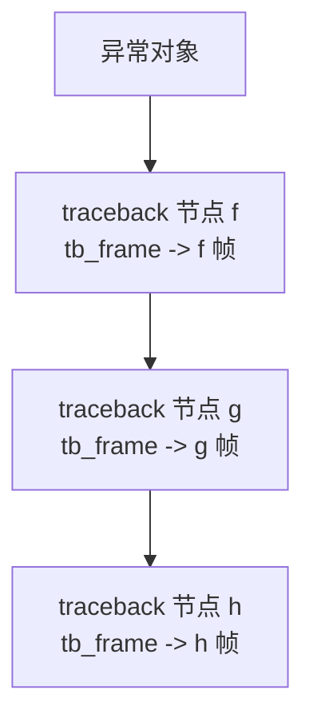
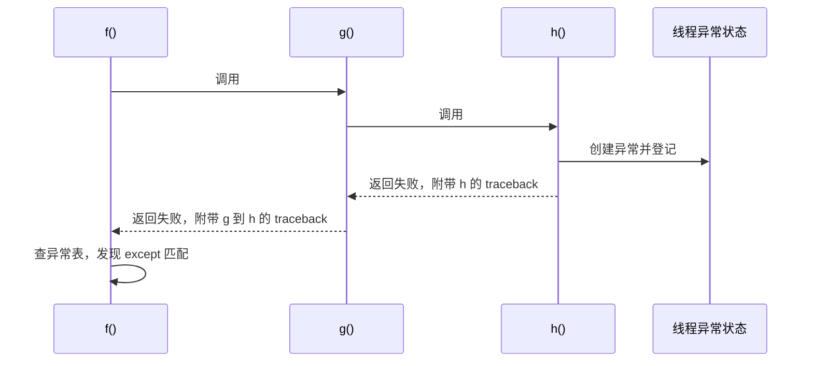

> 本篇是 D2《对象模型 & 类型系统》的补充，重点不是语法，而是把“变量、对象、帧、栈、堆、异常追溯链”放在一张内存图里理解。
> 读的时候可以始终问自己一句：**这个东西是名字、是指针，还是对象本身？**

## 一、先建立总图

Python 的内存世界可以先粗分成两块：

1. **栈**：负责“执行现场”。函数调用、返回、局部流程都靠它。特点：后进先出，函数返回时通常自动弹出。
2. **堆**：负责“对象仓库”。列表、字典、字符串、异常对象、traceback 节点等大多在堆上。对象靠引用活着，没人引用才可能被回收。

再补两个核心词：

- **帧 frame**：一次函数调用的执行现场，记录“现在是哪个函数、执行到哪、局部变量是什么、谁调用了它”。
- **变量**：不是装对象的盒子，而是命名空间里的一个名字，绑定到某个对象。CPython 实现层用 `PyObject *` 指针保存这种“绑定”。

一句话对照：

| 语言     | 变量是什么              | 对象/数据在哪里        |
| ------ | ------------------ | --------------- |
| C      | 变量是一块真正分配的内存空间     | 栈、堆、全局区，取决于存储类别 |
| Python | 变量是命名空间里的键，指向对象的引用 | 绝大多数对象在堆上       |

---

## 二、C 语言中的内存模型（用来做对照）

### 1. C 的变量：一块内存空间

```c
int a = 10;
```

这里 `a` 是一块内存，编译器根据 `int` 决定它占多少字节。赋值的本质是把 `10` 的二进制表示写进这块空间。

所以 C 的变量：

- 有自己的地址；
- 有固定类型和固定大小；
- 变量本身就承载数据；
- 类型在编译期确定。

### 2. C 的栈

栈是函数调用的工作区，通常保存：

- C 局部变量；
- 函数参数；
- 返回地址；
- 临时寄存器保存区。

函数返回后，这块栈空间自动弹出，不需要手动释放。

### 3. C 的堆

堆是动态分配区：

```c
int *p = malloc(sizeof(int) * 10);
```

特点：

- 生命周期由程序员控制；
- 用 `malloc/free` 或 `new/delete` 管理；
- 容量大，分配/释放比栈慢；
- 忘了释放会内存泄漏，释放后继续用会悬空。

### 4. C 的指针

指针变量保存的是地址。指针“指向一个变量”，本质是保存这个变量的地址。使用时解引用，表示“按这个地址去访问，再按指针类型解释这段内存”。

理解 C 的这一层后，再看 Python 会轻松很多：**Python 把很多底层内存操作藏起来了，但“引用指向对象”这件事仍然存在。**

---

## 三、Python 中的变量与对象

### 1. 变量不是盒子，是命名空间里的键

```python
a = [1, 2, 3]
```

不要理解成“`a` 这个盒子里装了一个列表”。更准确的理解是：

1. 先在堆上创建一个列表对象；
2. 当前命名空间里加入一个键 `a`；
3. `a` 绑定到这个列表对象。

命名空间本质上是一个字典：名字是键，对象是值。

```text
当前命名空间
{
    "a":  -> 堆上的列表对象 [1, 2, 3]
}
```

### 2. D2 里“变量不是指针”和 CPython 用指针实现引用，怎么统一

D2 说“变量不是指针”，是在**Python 语言语义层**说的：

- 变量不是有独立地址、有固定类型、有固定大小的实体；
- 变量只是命名空间里的一个名字；
- 变量本身没有“值”，它只是绑定到对象。

CPython 实现层确实用指针保存引用：

- 命名空间字典的值槽里放的是 `PyObject *`；
- 帧的局部变量槽里放的也是 `PyObject *`；
- 赋值 `b = a` 复制的是这个指针，不是对象。

所以两句话并不矛盾：

- **语言层：变量是名字，不是实体。**
- **实现层：这个名字对应的槽位里存了一个指向对象的指针。**

### 3. 对象在堆上

CPython 中的对象通常有一个头部：

```c
Py_ssize_t ob_refcnt;   // 引用计数
PyTypeObject *ob_type;  // 指向类型对象
```

后面才是对象自己的数据。不同类型的数据区不一样：

- `int`：存数字；
- `str`：存字符数据；
- `list`：存一个指向“指针数组”的指针，数组里每个槽再指向其他对象；
- `dict`：存哈希表结构；
- `exception`：存 `args`、`traceback`、`context`、`cause` 等引用。

所以 Python 里的“对象”可以理解成 C 里的结构体，但又比普通 C 结构体多了一层引用计数和类型信息。

### 4. 变量赋值传递的是引用

```python
a = [1, 2]
b = a
```

这时：

```text
a  -> 列表对象
b  -> 同一个列表对象
```

改 `a` 看到的也是 `b` 的变化，因为没有复制列表。

`del a` 只是删除名字 `a`，让列表的引用计数减一。对象是否消失，要看还有没有人引用它。

### 5. 连接 D2：id、is、== 和拷贝

| 写法 | 比较/做的事情 |
|---|---|
| `id(a)` | CPython 中通常可看作对象地址，实际语义是对象身份 |
| `is` | 两个名字是否指向同一个对象 |
| `==` | 两个对象的值是否相等 |
| 赋值 | 贴标签，复制引用，不复制对象 |
| 浅拷贝 | 新建外层容器，内层元素仍然共享 |
| 深拷贝 | 递归新建对象，尽量完全独立 |

列表存的是指针数组。浅拷贝只换外壳，内部指针仍指向原来的对象；深拷贝会沿着嵌套结构继续复制，直到最底层的不可变对象。

---

## 四、帧 Frame：函数的执行现场

### 1. 帧是什么

调用一个 Python 函数时，CPython 需要记录这次调用的现场。这个概念就是帧。

帧里关心这些信息：

| 属性 | 含义 |
|---|---|
| `f_code` | 当前代码对象，包含函数名、字节码等 |
| `f_globals` | 全局命名空间 |
| `f_locals` | 局部命名空间 |
| `f_lineno` | 当前执行到第几行 |
| `f_lasti` | 当前字节码偏移 |
| `f_back` | 调用当前函数的上层帧 |

### 2. 帧链就是逻辑上的 Python 调用栈

```python
def h():
    pass

def g():
    h()

def f():
    g()
```

调用过程：

```text
f 帧
  ↑ f_back
g 帧
  ↑ f_back
h 帧
```

`frame.f_back` 的方向是：**从内层指回外层**。

### 3. CPython 3.11+ 的一个实现补充

概念上，帧是函数调用现场；实现上，CPython 3.11 之后引入了“解释器帧”和“惰性帧对象”。

- 解释器帧负责真正执行字节码；
- Python 可见的 `PyFrameObject` 常在需要时才开始创建；
- traceback、调试器、`sys._getframe()` 等场景会促使帧对象实体化。

学习阶段先记住概念模型即可：**帧是执行现场，帧链是调用栈。**

---

## 五、栈 Stack：四种容易混用的“栈”

### 1. C 调用栈（机器栈）

保存 C 函数的返回地址、参数、局部变量等。C 函数返回后自动弹出。

### 2. Python 调用栈（帧链）

逻辑上的函数调用关系：

```text
main 帧 -> f 帧 -> g 帧 -> h 帧
```

通过 `f_back` 连接。它不是单独的一块内存，而是帧对象之间的逻辑链条。

### 3. 字节码求值栈（操作数栈）

每个帧内部还有一个临时工作台，用于执行字节码：

```python
1 + 2
```

大致流程：

1. 把 `1` 压入求值栈；
2. 把 `2` 压入求值栈；
3. 执行加法，弹出两个值；
4. 把结果 `3` 压回去。

它负责表达式计算，不是函数调用栈。

### 4. 异常处理栈 `exc_info`

这是线程状态里的一个异常栈，记录“当前正在被 `except` 处理的异常”。

- 进入 `except`：把当前异常压入；
- 离开 `except`：恢复上一层；
- `sys.exc_info()`、`sys.exception()`、无参数 `raise` 都依赖它。

### 5. 四种栈的对照

| 名称 | 存什么 | 生命周期 |
|---|---|---|
| C 调用栈 | C 局部变量、返回地址、参数 | C 函数返回时自动弹出 |
| Python 调用栈 | 帧的逻辑链条 | 函数返回通常弹出，但可能被引用延长 |
| 字节码求值栈 | 字节码计算时的临时值 | 表达式计算时不断进出 |
| 异常处理栈 | 当前正在处理的异常 | except 嵌套期间存在 |

---

## 六、堆 Heap：对象真正的仓库

### 1. Python 对象在堆上

```python
x = [1, 2, 3]
```

可以画成：

```text
变量槽 x  ->  堆上的列表对象
                  ├── 指向整数 1
                  ├── 指向整数 2
                  └── 指向整数 3
```

列表对象本身不直接存 `1、2、3` 的数值，而是存一个指针数组，数组槽里指向整数对象。

### 2. 对象的生死：引用计数 + GC

CPython 以引用计数为主：

- 创建变量、把对象放进容器，会增加引用计数；
- `del`、重新绑定、离开作用域，会减少引用计数；
- 引用计数归零，对象的内存被归还堆。

引用计数管不了循环引用，于是还有循环垃圾回收器 `gc`。

```python
import gc
gc.collect()
```

### 3. 小整数缓存

CPython 启动时会预先创建一批小整数对象，通常范围是 `-5` 到 `256`。程序用到这个范围内的整数时，会复用同一个对象。

```python
a = 100
b = 100
print(a is b)  # True，通常复用同一个整数对象
```

注意：复用的是整数对象，不是变量。变量仍然是命名空间里的名字。

### 4. pymalloc

CPython 对小对象还有自己的内存池 `pymalloc`，用 arena 和 pool 管理。概念上仍属于堆，只是分配策略更高效。

---

## 七、异常机制中的内存关系

### 1. 异常对象

异常对象是堆上的一个 `BaseException` 子类实例，可以把它想成一份“事故报告”。

它关心这些属性：

| 属性 | 含义 |
|---|---|
| `args` | 构造异常时传入的参数 |
| `__traceback__` | 异常经过的帧链 |
| `__context__` | 处理一个异常时又抛出另一个异常，自动形成因果链 |
| `__cause__` | `raise X from Y` 里的 `Y` |
| `__suppress_context__` | `raise X from None` 时抑制上下文显示 |
| `__notes__` | `add_note()` 添加的附加说明 |

CPython 内部的 `PyBaseExceptionObject` 大致是：

```c
typedef struct {
    PyObject_HEAD
    PyObject *dict;
    PyObject *args;
    PyObject *traceback;
    PyObject *context;
    PyObject *cause;
    char suppress_context;
} PyBaseExceptionObject;
```

### 2. 异常对象里存的是指针还是数据本身

结论：**对象本身在堆上，字段大多是指针，少量 C 标量内联。**

- `ob_refcnt`：内联整数；
- `ob_type`：指向类型对象；
- `dict`：指向属性字典；
- `args`：指向元组对象；
- `traceback`：指向 traceback 链头；
- `context`、`cause`：指向其他异常对象；
- `suppress_context`：内联字符。

```python
e = ValueError("bad", 42)
```

`e.args` 是元组：

```text
e.args -> 元组对象
            ├── PyObject* -> 字符串对象 "bad"
            └── PyObject* -> 整数对象 42
```

没有深拷贝。修改 `e.args` 里引用的可变对象，异常对象看到的内容也会变。

### 3. 异常帧

“异常帧”通常指 traceback 链里引用到的某个 frame。它不是独立类型，本质就是普通帧对象。

traceback 节点大致是：

```c
typedef struct _traceback {
    PyObject_HEAD
    struct _traceback *tb_next;
    PyFrameObject *tb_frame;
    int tb_lasti;
    int tb_lineno;
} PyTracebackObject;
```

- `tb_frame`：指向帧对象；
- `tb_lineno`：异常到达这个帧时的行号；
- `tb_lasti`：字节码偏移；
- `tb_next`：指向下一个 traceback 节点。

### 4. 异常追溯链是怎么长出来的

异常向上传播时，每经过一个 Python 帧，就生成一个 traceback 节点。



如果异常在 `h` 里产生，最后在 `f` 里被捕获，链的形状是：

```text
e.__traceback__                    -> tb(f)
e.__traceback__.tb_next            -> tb(g)
e.__traceback__.tb_next.tb_next    -> tb(h)
```

方向要分清：

- `frame.f_back`：从内层指回外层；
- `traceback.tb_next`：从最外层节点指向更内层节点。

所以打印 traceback 时，外层先打印，内层最后打印。表头 `Traceback (most recent call last)` 表示最后一行才是最近一次调用，也就是真正出错的位置。

### 5. raise 为什么向上抛

“向上抛”不是瞬间跳到最外层，而是让异常沿着函数调用的返回方向，一层层退回去。



CPython 底层的近似过程：

1. C 函数失败时返回 `NULL` 或 `-1`，并用 `PyErr_SetString`、`PyErr_SetObject`、`PyErr_Format` 登记错误。
2. 求值循环发现错误，查当前 code object 的 `co_exceptiontable`。
3. 当前帧没有 handler，就记录 traceback，然后把失败状态返回给调用者。
4. 调用者重复同样过程，直到某个 `except` 匹配成功。
5. 没人接住，就退到顶层，由 `sys.excepthook` 打印 traceback。

这里要区分：

- **异常对象**：事故报告本身；
- **异常状态/错误指示器**：线程级状态，说明当前有异常正在传播，异常对象是核心载荷；
- **traceback 链**：异常经过的帧路线；
- **异常处理栈 `exc_info`**：当前正在被 `except` 处理的异常栈。

`PyErr_SetString` 并不是只存一个字符串，它会构造异常对象，再把异常对象登记到当前线程状态里。字符串只是进入 `args`。

### 6. 上下文异常和原因异常

`__traceback__` 描述“一个异常经过了哪些帧”；`__context__` 和 `__cause__` 描述“异常对象之间的因果链”。

```python
try:
    1 / 0
except ZeroDivisionError as e:
    raise ValueError("转换失败") from e
```

这时：

```text
ValueError.__cause__ -> ZeroDivisionError
```

如果去掉 `from e`，则自动设置 `__context__`：

```text
ValueError.__context__ -> ZeroDivisionError
```

`raise X from None` 会设置 `__suppress_context__`，隐藏上下文显示。

---

## 八、生命周期、内存滞留和常见误区

### 1. 栈上的东西

函数返回后，对应的执行现场通常会从活动调用栈弹出。

### 2. 堆上的东西

只要还有引用，堆对象就活着。

### 3. 异常对象可能延长帧的生命

```text
异常对象 -> traceback -> 帧 -> 局部变量 -> 其他对象
```

这条链可能让本该结束生命的对象继续存活。

长期保存异常对象时要注意：

```python
import traceback

traceback.clear_frames(e.__traceback__)
```

它可以清掉 traceback 里帧对象的局部引用，帮助回收。

### 4. 常见误区

1. 把 Python 变量当成 C 变量，以为变量本身装对象。
2. 把“栈”只理解成一种东西，忽略 C 栈、Python 帧链、求值栈、异常处理栈的区别。
3. 以为 `del` 一定销毁对象，其实只是减少引用。
4. 以为异常对象只存消息字符串，其实它存的是 `args` 和一堆对象指针。
5. 以为 traceback 是调用栈本身，其实它是异常经过帧的追溯链。
6. 以为 `except` 匹配的是报错消息，其实匹配的是异常类型和继承关系。

### 5. 栈溢出和堆溢出

- 无限递归不断建立帧，触发 `RecursionError`，这是在保护调用栈。
- 堆上分配过大对象或对象太多，可能触发 `MemoryError`。
- 递归限制设得过高，可能超出 C 栈承受能力，直接崩溃。

---

## 九、速查总结

| 概念 | 通俗理解 | 存放位置 | 作用 |
|---|---|---|---|
| 变量名 | 取货单 | 命名空间或帧槽位 | 指向对象 |
| 对象 | 仓库里的货 | 堆 | 存数据、类型、引用计数 |
| 帧 | 任务卡 | 解释器帧，实体化后是堆对象 | 记录一次函数调用的现场 |
| Python 调用栈 | 任务卡链 | 逻辑上是帧链 | 表示函数调用关系 |
| C 调用栈 | 机器工作区 | 线程栈 | 保存 C 局部变量和返回地址 |
| 求值栈 | 临时工作台 | 帧内部 | 执行字节码时压入弹出 |
| 异常处理栈 | 案件文件夹 | 线程状态 | 记录当前正在处理的异常 |
| 异常对象 | 事故报告 | 堆 | 携带消息、参数和因果链 |
| traceback | 行车记录仪 | 堆 | 记录异常经过的帧和行号 |

**最后三句话：**

1. **变量是取货单，对象在堆里。**
2. **帧是执行现场，调用栈是帧的链条。**
3. **异常对象和 traceback 在堆里；traceback 指向帧，所以异常能保留出错现场，也可能延长局部变量的生命。**

---

## 十、与 D2 的衔接

D2 讲的是对象模型与类型系统，本篇补充的是这些概念在内存层面的落点：

- `id/is/==` 的差别，最终落到“对象身份、对象地址、对象值”上；
- 浅拷贝和深拷贝的差别，最终落到“容器里存的是指针，指针是否重新创建”上；
- 可变与不可变的差别，最终落到“能不能原地改对象，还是必须新建对象再重新绑定”上；
- 异常追溯链的差别，最终落到“异常对象持有 traceback 指针，traceback 又引用帧”上。

把这些连起来，对象模型就不再只是“变量指向对象”这样一句话，而是一张由命名空间、帧、栈、堆、引用和异常链共同组成的内存图。
