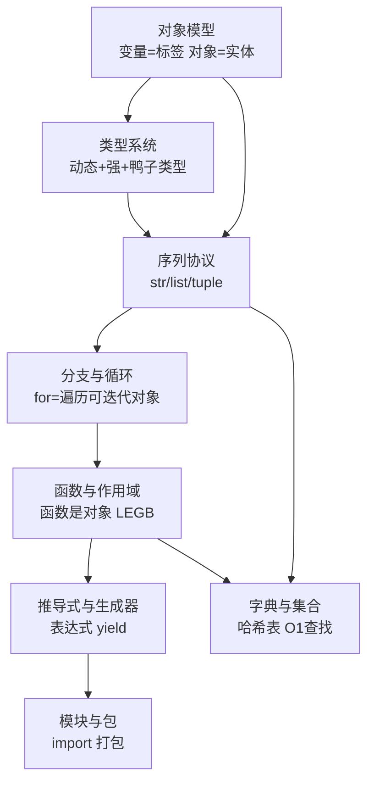

> **蒸馏说明**：本篇将语法主线（D1–D7 + 三个专题）合并为单一线索，去除重复，保留底层原理。括号内为原始笔记出处。

---

## 一、对象模型——一切语法的地基（D2）
1. 变量不是实体：**变量是命名空间字典中的一个键，本身无意义**——"引用语义"，区别于 C 的内存空间
2. 对象才是实体：C 结构体 = 头（引用计数+类型指针）+ 数据区（可变长数组，故 int 无精度限制）
3. 容器不存值：list 数据区永远是指针数组（`PyObject **ob_item`），槽里装指针——异构、共享、浅拷贝三大现象的根源
4. 生死靠引用计数：del 撕标签，归零归还堆
5. 三重比较：id() 看地址；is 比身份；== 比值。**判断相等一律用 ==**
6. 小整数池：-5~256 预建复用，是 is 的"陷阱"来源；str 的驻留（interning）同理

## 二、类型系统（D2）
| 维度 | C | Python |
|---|---|---|
| 检查时机 | 编译期（静态） | 运行期（动态） |
| 类型位置 | 声明在变量上 | 存在对象头部 |
| 隐式转换 | 有（弱） | 无，直接报错（强） |
| 声明形式 | 显式（int x） | 隐式（鸭子类型） |
可变性：list/dict/set 可原地修改；int/float/str/tuple 不可变——"修改"实为新建对象重绑定
可哈希：不可变 → 内容不变 → 摘要不变 → 可作 dict 键 / set 元素
## 三、序列协议——str/list/tuple 三兄弟（D4）
1. 共性：有序、可下标、可切片；len() O(1)（长度存头部，不必扫到 \0）
2. 底层：CPython 的 `PySequenceMethods` 函数指针表——负索引/切片/in 都经此分派到 C 实现
3. 切片：前开后闭；负跨度 -1 倒序；**索引越界报 IndexError，切片越界静默裁剪**
4. str 特有：惰性缓存哈希；标识符样式字面量被驻留；is 陷阱同 D2
5. join 优于 +：字符串不可变，+ 每次新建中间对象 O(N²)；join 先算总长一次分配 O(N)

## 四、分支、循环与真值（D3 + D3b）
1. 缩进即从属——区分 C 的大括号
2. for = 遍历可迭代对象；range() 前闭后开补足"数字序列"
3. match-case：值匹配 + 结构匹配（拆快递绑定变量）；**case x 是捕获赋值，case "x" 才是比较**
4. 真值性：空容器/0/None/False 为假；and/or 返回操作数（短路逻辑），not 返回布尔
5. input() 只做三件事：读一行 → 去 \n → 返回字符串；解析数字须显式转换
6. 流：连续、有序、单向——协议与流的共性是"契约式抽象"

## 五、函数、作用域与闭包（D5）
1. 函数是对象：壳（PyFunctionObject，存上下文）+ 指针指向代码对象（干货，存字节码）
2. 调用四步：分配槽建对象 → 建栈帧 → 执行字节码 → 返回并销毁栈帧
3. 参数四类：位置、关键字（`名=值`）、默认（定义时，放最后）、收集（`*` 打包成元组）
4. LEGB：Local → Enclosing → Global → Built-in，从高到低覆盖
5. 存储位置决定生死：局部变量在栈帧（帧亡变量亡）；全局在字典；自由变量在堆上 cell 对象
6. 闭包 = 外层作用域借 cell 对象"活下来"：cell 同时被内外层指向，引用计数不为零
7. 装饰器 = 把函数当参数传 + @语法糖；工厂函数/有记忆函数是闭包的两大应用

## 六、推导式、迭代器与生成器（D6 + 迭代器专题）
1. 推导式是有值的表达式：`[表达式 for 变量 in 可迭代对象 if 条件]`——快在省去每次查 append 方法
2. iter() 雇手、next() 取货：底层走 `tp_iter` / `tp_iternext` 函数指针槽
3. 迭代器只存两样：**底层数据指针 + 游标**；next 传引用不复制（str 迭代器例外：每次新建单字符）
4. 生成器 ⊂ 迭代器：yield 使函数变生成器；**底层核心 = 暂停的栈帧 + 计数器指针**，冻结即把帧挂到堆上
5. "可迭代对象"≠ 迭代器："货"与"手"；每次 iter() 得全新游标，互不影响
6. 表达式 vs 语句：表达式有值可进 print/eval；语句只做动作。四对孪生见 表达式&语句

## 七、字典与集合——哈希表（字典&集合专题）
1. dict = 紧凑表：dk_indices（稀疏索引墙）+ dk_entries（按插入顺序存条目，故 3.6+ 保序）
2. 查找：hash(key) & mask 定槽 → 线性探测 → 先比哈希再比 key；全 str 键走 lookdict_unicode 加速
3. 删除留 dummy 墓碑：防止探测链断裂丢元素；扩容时才清
4. 装填率超 2/3 翻倍扩容；空 dict 惰性初始化（仅 64 字节，首次插入才建键表）
5. set = 只有键的字典：互异性天然去重；frozenset 不可变可作键
6. 集合运算：并 |、交 &、差 -、对称差 ^；remove 报错，discard 静默

## 八、模块与包（D7）
1. 单个 .py 文件即模块；import / from ... import / import ... as 三种访问形式

---

**全主线一图**（按依赖关系自底向上）：

**贯穿全篇的三条暗线**：
1. **指针数组**：list 异构 → 浅拷贝陷阱 → 迭代器传引用 → 序列协议分派，全部同源
2. **引用计数与对象生死**：del → 小整数池复用 → 闭包 cell 存活 → 生成器帧挂堆，一条因果链
3. **函数指针表（协议）**：鸭子类型 → 序列协议 → 迭代器协议 → dk_lookup 按类型选查找函数——"只规定行为，不管实现"
